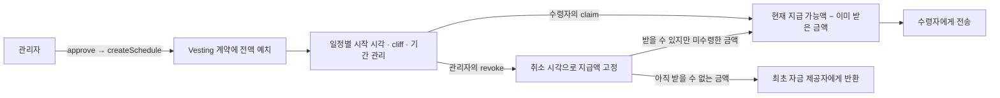

# Token Vesting

[](https://github.com/0Chord/vesting/actions/workflows/test.yml)


**정해진 시간에 따라 ERC-20 토큰을 나누어 지급하는 스마트컨트랙트입니다.**

토큰을 한 번에 전달하는 대신 계약에 예치하고, 수령자가 시간이 지난 만큼 청구하도록 구현했습니다. 일정이 중간에 취소되더라도 이미 받을 수 있게 된 금액과 반환할 금액을 구분합니다.

개인 학습 프로젝트로 계약과 테스트를 직접 작성했습니다. Solidity로 시간·권한·금액 처리 규칙을 표현하고, Foundry에서 시간을 바꿔 가며 경계 조건을 확인하는 데 집중했습니다.

[동작 예시](#동작-예시) · [서명 기반 등록](docs/signed-registration.md) · [설계와 구현](#설계와-구현) · [실행하기](#실행하기) · [로컬 배포와 호출](#로컬-배포와-호출) · [Sepolia 배포](#sepolia-배포) · [테스트](#테스트) · [코드 안내](#코드-안내)

| 구분 | 내용 |
| --- | --- |
| 구현 기간 | 2026.08 — 계약 구현 및 단위 테스트 작성 |
| 사용 기술 | Solidity · Foundry · OpenZeppelin · GitHub Actions |
| 구현 범위 | 단일 ERC-20 토큰, 여러 지급 일정, 선형 지급, cliff, 청구, 취소·반환, EIP-712 서명 기반 등록 |
| 현재 상태 | 계약·실패/재진입/fuzz/invariant 검증·Anvil 로컬 배포/호출 예제·Sepolia 두 계약 배포 및 Etherscan 소스 검증 완료 |

## 지급 흐름



계약 하나가 사용하는 토큰은 배포 시 정해지며 변경할 수 없습니다. 각 일정에는 수령자, 최초 자금 제공자, 총액, 누적 수령액, 시작 시각과 지급 기간을 따로 저장합니다.

## 동작 예시

설명을 위해 **1,000토큰 · 지급 기간 100일 · cliff 20일**인 일정을 가정합니다. 실제 체인에서는 초 단위의 `block.timestamp`와 토큰의 정수 최소 단위로 계산합니다.

| 시점과 행동 | 누적 지급 가능액 | 실제 이동 |
| --- | ---: | --- |
| 일정 생성 | 0 | 자금 제공자 → 계약: 1,000토큰 예치 |
| 시작 후 19일 | 0 | cliff 이전이므로 청구 불가 |
| 시작 후 20일 | 200 | 시작일부터 쌓인 금액을 청구할 수 있음 |
| 50일에 첫 청구 | 500 | 계약 → 수령자: 500토큰 |
| 75일에 관리자가 취소 | 750으로 고정 | 계약 → 최초 자금 제공자: 250토큰 반환 |
| 취소 후 수령자가 청구 | 750 | 이미 받은 500을 제외한 250토큰 지급 |

**cliff는 청구를 시작할 수 있는 시점입니다.** cliff부터 새로 금액을 쌓는 방식이 아니라, cliff에 도달하면 시작일부터 경과한 시간을 계산에 반영합니다. 다만 cliff 이전에 취소되면 지급 가능액은 0으로 고정되어 전액 반환됩니다.

취소하지 않고 종료 시점까지 진행하면 총액 전부가 지급 가능해집니다. 수령자는 이미 받은 금액을 제외한 나머지를 청구할 수 있습니다.

## 설계와 구현

### 1. 누적 지급액과 실제 청구액을 분리

`vestedAmount`는 이미 받은 금액까지 포함한 누적 지급 가능액이고, `releasableAmount`는 지금 추가로 청구할 수 있는 금액입니다.

```text
cliff 이전              : 지급 가능액 = 0
cliff 이후 ~ 종료 직전  : 지급 가능액 = floor(총액 × 경과 시간 / 전체 기간)
종료 시점 이후          : 지급 가능액 = 총액

추가 청구액 = 지급 가능액 − 누적 수령액
```

선형 계산에는 `Math.mulDiv`를 사용해 중간 곱셈의 오버플로를 피합니다. 종료 시점에는 총액을 반환하므로 정수 나눗셈으로 남은 금액도 마지막에 청구할 수 있습니다. 새로 받을 금액이 없으면 `NothingToClaim`으로 거절합니다.

구현: [`_vestedAmount`, `releasableAmount`, `claim`](src/Vesting.sol)

### 2. 토큰을 보내기 전에 권한과 상태부터 확인

직접 일정 생성과 취소에는 `onlyOwner`를 적용했습니다. 서명 기반 등록은 관리자가 서명한 조건을 지정 수령자가 제출하며, 청구도 해당 일정의 수령자만 할 수 있습니다. 두 생성 경로 모두 최초 제공자의 토큰을 전액 예치합니다. [서명 등록의 흐름과 테스트](docs/signed-registration.md)에서 승인 번호·마감·관리자 변경 규칙을 확인할 수 있습니다.

`claim`은 호출자와 청구액을 확인한 뒤 **누적 수령액을 먼저 갱신하고 토큰을 전송**합니다. 외부 계약을 호출하기 전에 상태를 변경하는 Checks-Effects-Interactions 순서로 작성했으며, 생성·청구·취소에 `nonReentrant`를 적용했습니다. 토큰 전송은 `SafeERC20`으로 처리합니다.

구현: [`createSchedule`, `claim`, `revoke`](src/Vesting.sol)

### 3. 취소 이후에도 미수령분은 남김

취소 시 `revokedAt`을 기록하고, 이후 지급액 계산에는 현재 시각 대신 취소 시각을 상한으로 사용합니다. 시간이 더 지나도 지급 가능액은 늘어나지 않습니다.

반환액은 `총액 − 취소 시점의 지급 가능액`입니다. 이미 지급한 금액을 회수하지 않으며, 지급 가능하지만 아직 받지 않은 금액은 계약에 남겨 수령자가 청구하도록 했습니다. 반환 대상은 현재 관리자가 아닌 **일정을 만들 때 기록한 최초 자금 제공자**입니다.

구현: [`revoke`, `_vestedAmount`](src/Vesting.sol)

### 4. 약정한 금액이 실제로 들어왔는지 확인

일정 생성 전에 관리자가 계약에 토큰 사용을 승인해야 합니다. `createSchedule`은 전액을 전송받은 뒤 계약 잔고의 증가분이 요청한 금액과 일치하는지 확인합니다.

전송 수수료 등으로 실제 수령액이 다르면 `UnsupportedToken`으로 되돌립니다. 이 검사는 일정 생성 시의 입금액에 대한 검증이며, 모든 비표준 ERC-20 동작을 지원한다는 의미는 아닙니다.

구현: [`createSchedule`](src/Vesting.sol)

## 실행하기

[Foundry](https://getfoundry.sh/introduction/installation/)와 Git이 필요합니다. 의존성은 Git submodule에 지정된 커밋을 사용합니다.

```bash
git clone --recurse-submodules https://github.com/0Chord/vesting.git
cd vesting

forge build
forge test -vvv
```

이미 clone했다면 의존성을 먼저 가져옵니다.

```bash
git submodule update --init --recursive
```

Forge 테스트는 로컬 EVM에서 실행됩니다. 별도 RPC 주소, 지갑 개인 키, 실제 토큰이 필요하지 않습니다. 아래 로컬 호출 예제는 자체 Anvil RPC를 사용합니다.

## 로컬 배포와 호출

[학습 #10](https://github.com/0Chord/vesting/issues/10)은 제공자 P와 수령자 B를 서로 다른 로컬 계정으로 두고 실제 거래를 보냅니다. P는 관리자이자 최초 자금 제공자입니다. **제공자 잔고는 P가 가진 ERC-20 토큰 수, Vesting 잔고는 계약 주소에 예치된 같은 토큰 수**입니다. 가스비에 쓰는 ETH와 구분합니다.

실행 도구는 **Solidity·Forge·Anvil·Cast·Bash**입니다. Git과 기본 셸 유틸리티를 사용하며 별도 언어나 JSON 처리 패키지를 설치하지 않습니다. 이 로컬 예제는 Foundry 1.5.1-stable에서 검증했습니다. Sepolia의 MetaMask 배포에는 아래 안내의 v1.7.0을 사용했습니다.

```bash
# 먼저 배포·승인·생성까지만 확인
bash script/local-vesting-flow.sh --through create

# 새 체인에서 청구·취소·최종 정산까지 실행
bash script/local-vesting-flow.sh

# 별도의 새 체인에서 같은 흐름을 다시 재현
bash script/local-vesting-flow.sh
```

매번 fork 없는 새 Anvil을 `127.0.0.1:18545`, chain ID31337로 시작하고 끝에 종료합니다. 사용 중인 포트에서는 실패하며 기존 노드를 reset하거나 종료하지 않습니다. `--port 18546`으로 바꿀 수 있습니다. 실행마다 새 계약이므로 이전 중간 상태를 이어받지 않습니다. 주소·ID가 반복될 수 있어 실행별 디렉터리로 구분합니다.

| 도구·파일 | 담당 역할 |
| --- | --- |
| [DeployLocal.s.sol](script/DeployLocal.s.sol) + Forge | 토큰·Vesting을 제공자 계정으로 실제 배포 |
| [local-vesting-flow.sh](script/local-vesting-flow.sh) + Anvil/Cast | 새 노드 수명, 계정·배포 결과 연결, 별개 거래 전송, 다음 거래의 블록 시간 지정 |
| [CheckLocal.s.sol](script/CheckLocal.s.sol) + Forge | Cast의 JSON을 typed JSON으로 읽고 receipt·trace·이벤트·약정·잔고를 Solidity assertion으로 검사. broadcast하지 않는 검증 스크립트 |

첫 학습 대상은 다음 표입니다. 설명은 토큰 수이고 실제 검사에서는 18 decimals의 정수 최소 단위를 사용합니다.

| 행동 직후 | 제공자 | Vesting | 수령자 | 남은 승인량 |
| --- | ---: | ---: | ---: | ---: |
| 1,000 발행 | 1,000 | 0 | 0 | 0 |
| 승인 전 생성 거절 | 1,000 | 0 | 0 | 0 |
| approve 성공 | 1,000 | 0 | 0 | 1,000 |
| 잘못된 수령자로 생성 거절 | 1,000 | 0 | 0 | 1,000 |
| 유효한 일정 생성 | 0 | 1,000 | 0 | 0 |
| 19일 청구 거절 | 0 | 1,000 | 0 | 0 |
| 30일 300 청구 | 0 | 700 | 300 | 0 |
| 같은 블록 중복 시뮬레이션·권한 거절 | 0 | 700 | 300 | 0 |
| 40일 추가 100 청구 | 0 | 600 | 400 | 0 |
| 60일 취소·400 반환 | 400 | 200 | 400 | 0 |
| 100일 남은 200 청구 | 400 | 0 | 600 | 0 |

approve는 **Vesting의 토큰 사용 한도**를 정합니다. 수령자는 createSchedule에서 지정하고, 이 거래가 성공해야 실제 예치됩니다. 영주소 생성이 실패해도 앞선 별개 approve 거래는 남습니다. 실패한 한 거래 안의 상태 변경·토큰 이동은 함께 되돌아갑니다.

실제 거래는 생성 블록의 startTime 기준으로 시간을 맞추고 receipt와 실제 블록의 hash/번호/timestamp를 연결해 확인합니다. 승인 부족·영주소 생성·19일 청구·비수령자 청구·비관리자 취소는 **실제 hash/status0 및 정확한 transaction trace 오류**로 확인합니다. nonce·가스·ETH·블록 시각을 토큰/약정 보존과 혼동하지 않습니다.

30일 첫 청구 직후 중복은 **그 성공 블록으로 고정한 Forge 로컬 시뮬레이션**에서 NothingToClaim을 검사합니다. broadcast하지 않으며 Anvil의 실제 블록 번호도 보존됩니다. 이 검사는 채굴된 실패 거래나 직접 전송한 eth_call로 표시하지 않습니다.

출력 마지막의 `cache/local-vesting/run-*/summary.txt`는 `complete`/`creation-complete`/`failed`, 종료 원인과 노드 정리를 구분합니다. 같은 디렉터리의 context.json·broadcast·receipt/trace/transaction JSON·명령 로그·소스 해시에 실제 주소·ID·시각과 실행 근거를 남깁니다. 배포도 실제 블록 JSON과 `deployment-time-*.json`에 시각을 남깁니다. `state-before-*.json`/`state-after-*.json`에는 각 거래 전후의 실제 잔고·승인·약정 9필드·지급 의무를 보존합니다. 금액은 최소 단위 정수(`Raw`)와 소수 18자리 토큰 수(`Tokens`)를 함께 표시하며 실행 중에도 출력합니다. 전체 실행의 `final-settlement.json`으로 수령600·반환400·잔고/의무0을 다시 읽을 수 있습니다. Solidity의 파일 읽기/쓰기 권한은 이 cache 경로에만 부여합니다. Ctrl+C·SIGTERM·SIGHUP은 안전한 종료 지점에서 중단하고 자기 노드를 정리합니다. SIGKILL/시스템 강제 종료는 보장 범위 밖입니다.

<details>
<summary>수동 명령으로 승인과 예치의 차이 읽기</summary>

터미널1에서 로컬 노드를 시작합니다. 이 수동 노드가 켜진 동안 같은 포트의 자동 실행을 시작하지 않습니다.

```bash
anvil --host 127.0.0.1 --port 18545 --chain-id 31337 --timestamp 1700000000
```

터미널2의 저장소 루트에서 Anvil 출력의 첫·둘째 실제 계정을 아래 두 변수에 복사합니다. 꺾쇠 괄호는 설명 자리이며 그대로 실행할 값이 아닙니다.

```bash
LOCAL_RPC=http://127.0.0.1:18545
LOCAL_PROVIDER='<Anvil 첫 계정 주소>'
LOCAL_BENEFICIARY='<Anvil 둘째 계정 주소>'
forge script script/DeployLocal.s.sol:DeployLocal --sig 'run(address)' "$LOCAL_PROVIDER" --sender "$LOCAL_PROVIDER" --unlocked --broadcast --slow --rpc-url "$LOCAL_RPC"
```

위 배포의 Returns/broadcast 결과에서 나온 실제 token·vesting 주소를 아래 변수에 복사합니다. 자동 실행에서는 이 과정을 Foundry의 typed JSON과 Cast의 ABI 해독으로 연결합니다.

```bash
LOCAL_TOKEN='<방금 배포한 token 주소>'
LOCAL_VESTING='<방금 배포한 vesting 주소>'
LOCAL_AMOUNT=1000000000000000000000  # 1,000 × 10^18
cast send "$LOCAL_TOKEN" 'mint(address,uint256)' "$LOCAL_PROVIDER" "$LOCAL_AMOUNT" --from "$LOCAL_PROVIDER" --unlocked --rpc-url "$LOCAL_RPC"
cast send "$LOCAL_TOKEN" 'approve(address,uint256)' "$LOCAL_VESTING" "$LOCAL_AMOUNT" --from "$LOCAL_PROVIDER" --unlocked --rpc-url "$LOCAL_RPC"
# 승인만 했으므로 제공자 잔고는1,000이고 승인량도1,000이다.
cast call "$LOCAL_TOKEN" 'balanceOf(address)(uint256)' "$LOCAL_PROVIDER" --rpc-url "$LOCAL_RPC"
cast call "$LOCAL_TOKEN" 'allowance(address,address)(uint256)' "$LOCAL_PROVIDER" "$LOCAL_VESTING" --rpc-url "$LOCAL_RPC"
cast call "$LOCAL_VESTING" 'nextScheduleId()(uint256)' --rpc-url "$LOCAL_RPC"
cast send "$LOCAL_VESTING" 'createSchedule(address,uint256,uint64,uint64,uint64)' "$LOCAL_BENEFICIARY" "$LOCAL_AMOUNT" 0 1728000 8640000 --from "$LOCAL_PROVIDER" --unlocked --rpc-url "$LOCAL_RPC"
# 성공한 생성 receipt의 ScheduleCreated와 실제 잔고·승인량을 확인한다.
cast call "$LOCAL_TOKEN" 'balanceOf(address)(uint256)' "$LOCAL_VESTING" --rpc-url "$LOCAL_RPC"
cast call "$LOCAL_TOKEN" 'allowance(address,address)(uint256)' "$LOCAL_PROVIDER" "$LOCAL_VESTING" --rpc-url "$LOCAL_RPC"
```

새 계약은 ID0부터 시작하지만 실제 생성 전 ID와 receipt 이벤트·저장 startTime을 대조합니다. 같은 노드에서 재실행하면 기존 거래/배포가 남습니다. 처음부터 재현하려면 수동 Anvil을 Ctrl+C로 종료하고 새로 시작합니다. MockERC20의 공개 mint는 로컬 준비용이며 실제 토큰의 발행 권한 모델이 아닙니다.

</details>

## Sepolia 배포

2026-10-16에 MetaMask로 각각 서명하여 시험용 토큰과 Vesting을 Sepolia(chain ID `11155111`)에 배포했습니다. 두 계약 모두 Etherscan에서 `Pass - Verified`를 확인했습니다.

| 계약 | 주소·공개 소스 |
| --- | --- |
| MockERC20 (MTK) | [0x7e61a37fce010ad620b052273d23efe5dc94bba8](https://sepolia.etherscan.io/address/0x7e61a37fce010ad620b052273d23efe5dc94bba8#code) |
| Vesting | [0xa7894b86bdd8851303212c2fccc24d03fd34baff](https://sepolia.etherscan.io/address/0xa7894b86bdd8851303212c2fccc24d03fd34baff#code) |

위 표는 서명 등록 추가 전 배포의 기록입니다. 그 배포 블록에서 관리자·연결 토큰을 대조하고 공급량·제공자/계약의 토큰 잔고·일정 수가 모두 0임을 확인했습니다. 새 서명 등록 계약과 이후의 mint·approve·등록·청구 실행은 아래 MetaMask 실습 기록에 구분합니다. MTK는 누구나 발행할 수 있는 시험용 토큰이며 소스 검증은 외부 보안 감사를 뜻하지 않습니다.

[단계별 실행 안내](docs/sepolia-deployment.md)에서 기존 계약 조회, 새 배포, 소스 검증과 실패 후 재개를 따라갈 수 있습니다. [배포 기록](deployments/sepolia.json)에는 실제 거래·블록·시각·소스 커밋·컴파일 설정을 보관합니다.

## MetaMask 서명 등록 실습

관리자 P가 지급 조건에 서명하고, 수령자 B가 서명을 제출해 새 일정을 등록하는 [Sepolia 학습 예제](docs/signature-practice.md)입니다. 서명 화면은 로컬에서 실행하고 등록·청구 거래는 Foundry와 MetaMask로 직접 보냅니다. Node.js 22 이상이 필요하며 추가 패키지 설치는 없습니다.

```bash
node script/signature-practice/serve.mjs
```

MetaMask가 설치된 Chrome에서 `http://127.0.0.1:4173`을 엽니다. 이 화면은 지급 조건 서명을 요청합니다. `cast send --browser`가 여는 `127.0.0.1:9545`는 Foundry의 지갑 연결 화면입니다. 실제 계약과 거래는 Sepolia에 있습니다. 사용한 새 계약과 거래 기록은 [실행 기록](deployments/sepolia-signature-practice.json)에서 확인합니다.

## 테스트

Foundry 테스트에서는 `vm.warp`로 시간을 이동하고 `vm.prank`로 호출자를 바꿔 계약 상태와 토큰 잔고를 확인합니다. 테스트별 책임은 다음과 같습니다.

| 검증 대상 | 확인하는 동작 |
| --- | --- |
| 일정 생성 | 일정 저장, 전액 예치, 사용 승인 부족, 잘못된 수령자·금액·기간 거절 |
| 시간 경계 | cliff 직전과 정각, 기간 중간, 종료 직전·정각·이후의 지급액 |
| 청구 | 수령자 권한, 동일 시점의 반복 청구 거절, 새로 쌓인 금액만 지급, 종료 시 잔액 지급 |
| 취소 | 관리자 권한, 중복 취소 거절, 취소 시 지급액 고정, 미수령분 청구 |
| 청구와 취소의 조합 | 일부 수령 후 취소, cliff 전 전액 반환, 완전히 지급 가능해진 일정의 취소 거절 |
| [청구 전송 실패](test/VestingFailure.t.sol) | 실패 거래의 상태·잔고 보존과 이후 재시도 |
| [토큰 동작](test/VestingTokenBehavior.t.sol) | 생성/취소 실패, false·반환값 없음·입금액 불일치 |
| [재진입](test/VestingReentrancy.t.sol) | 유효 권한의 중첩 호출 차단과 오류 잡기/전파 |
| [Fuzz](test/VestingFuzz.t.sol) | 금액·시간·정수 내림 경계와 독립 지급 모델 |
| [Invariant](test/VestingInvariant.t.sol) | 복수 일정·행동 순서·관리자/제공자 구분·직접 입금·자금 장부 |
| [로컬 배포 도구](test/LocalVestingFlow.t.sol) | 배포 연결·빈 초기 상태·chain ID/제공자 거절. 실제 RPC는 위 실행 예제로 별도 확인 |
| [실행기 종료 회귀](test/local-vesting-cleanup.sh) | Bash로 실제 Anvil의 정상/실패 정리 시작에 첫 SIGTERM을 보내 노드·기록·원래 오류 보존 확인 |

```bash
# CI와 같은 검사
forge fmt --check
forge build --sizes
forge test -vvv

# 서명 실습 화면의 조건 구성·지갑 요청 검사 (RPC·실제 지갑 없이 실행)
node --test test/signature-practice/*.test.mjs

# 로컬 실행기의 종료 중 신호 처리 회귀 (실제 Anvil, 새 포트 사용)
bash test/local-vesting-cleanup.sh

# 청구 또는 취소 시나리오만 실행
forge test --match-test 'test_Claim_' -vvv
forge test --match-test 'test_Revoke_' -vvv
```

[GitHub Actions](.github/workflows/test.yml)에서 push와 PR마다 포맷·빌드·테스트를 실행합니다. 시나리오·실패 토큰·재진입·fuzz·invariant 검사를 포함합니다. CI의 Forge 검사와 실제 Anvil RPC 실행은 구분하며, 위 shell 예제는 CI 워크플로에서 자동 실행하지 않습니다.

## 코드 안내

```text
src/Vesting.sol              # 실제 일정 생성·청구·취소
script/DeployLocal.s.sol      # 로컬 토큰·Vesting 배포
script/local-vesting-flow.sh  # 로컬 실행 진입점
script/CheckLocal.s.sol       # JSON·receipt·trace·약정/자금·고정블록 시뮬레이션 검사
docs/sepolia-deployment.md   # MetaMask 직접 서명 배포·조회·소스 검증 안내
deployments/sepolia.json     # 실제 Sepolia 주소·거래·빌드 설정·확인 결과
test/Vesting*.t.sol           # 정상·실패·토큰·재진입·fuzz·invariant
test/LocalVestingFlow.t.sol   # 배포 도구의 빠른 검사
test/local-vesting-cleanup.sh # 정리 중 신호 회귀 (Bash)
test/mocks/                  # 정상/실패 토큰 대역
test/helpers/ReentrantActor.sol  # 재진입 호출자
test/handlers/VestingHandler.sol # invariant 행동 준비·독립 장부
.github/workflows/test.yml   # 형식·빌드·Forge·Node 검사 CI
foundry.toml                # fuzz256·invariant128×64 설정
```

처음 읽는다면 [동작 테스트](test/Vesting.t.sol)에서 청구·취소 시나리오를 보고, [계약 코드](src/Vesting.sol)의 `claim` → `revoke` → `_vestedAmount` 순서로 확인할 수 있습니다.

<details>
<summary><strong>주요 함수와 호출 권한</strong></summary>

| 함수 | 호출 권한 | 역할 |
| --- | --- | --- |
| `createSchedule` | 관리자 | 전액 예치 후 새 일정 생성. `startTime = 0`이면 현재 시각 사용 |
| `createScheduleWithSignature` | 서명에 지정된 수령자 | 관리자 서명을 검증하고 제공자 자금을 예치. 등록 성공 시 지급 시작 |
| `hashScheduleAuthorization` | 누구나 | 이 계약·체인의 지급 승인 서명용 해시 조회 |
| `claim` | 일정의 수령자 | 현재 청구 가능한 금액 전부 수령 |
| `revoke` | 관리자 | 지급액 고정 및 미확정 금액 반환 |
| `vestedAmount` | 누구나 | 누적 지급 가능액 조회 |
| `releasableAmount` | 누구나 | 지금 추가로 받을 금액 조회 |
| `getSchedule` | 누구나 | 일정별 상태 조회 |

</details>

## 완료 범위와 남은 확인

서명 기반 등록의 실제 MetaMask typed-data 서명·새 계약 Sepolia 배포·등록과 100 MTK 전액 청구를 확인했습니다. [실습 기록](deployments/sepolia-signature-practice.json)과 [재현 안내](docs/signature-practice.md)를 함께 읽을 수 있습니다. 위 초기 Sepolia 배포와 새 서명 등록 배포는 서로 다른 계약입니다.

프로젝트 전체의 커버리지 측정·정적 분석과 새 계약의 Etherscan 소스 검증은 별도 완료 근거를 확인해야 합니다. 테스트·AI 검토와 사람의 코드 이해·검토는 구분합니다.
